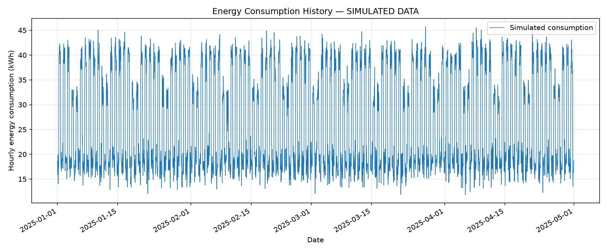
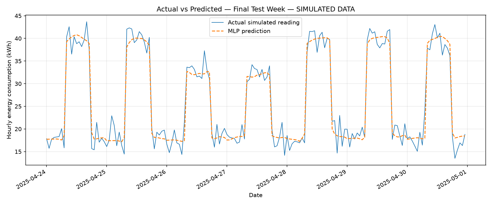
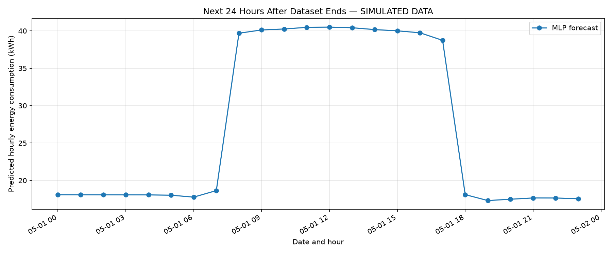

# AI-Powered Energy Consumption Forecasting

A Python project that predicts hourly electricity consumption using an MLP neural network, simulated building data, and a local Flask prediction API.

## Project goal

Demonstrate how historical electricity readings can be prepared, used to train a model, evaluated, and converted into future demand predictions.

Forecasts could support building energy planning by identifying expected periods of higher consumption. This project demonstrates that workflow through virtual simulation; it does not control equipment or measure electricity savings.

## Data source

This project uses **simulated data**, not real building measurements or corporate smart-grid logs.

The simulation generates:

- 120 days of hourly readings.
- 2,880 records beginning January 1, 2025.
- Higher consumption during working hours.
- Additional working-hour consumption on weekdays.
- Random variation with a fixed seed for repeatability.

Columns:

| Column | Meaning |
|---|---|
| Datetime | Date and hour of the reading |
| Energy | Electricity consumed during the hourly interval, in kWh |

## Technology

- Python 3.12
- pandas and NumPy for data preparation
- scikit-learn for the MLP model and evaluation
- matplotlib for graphs
- joblib for model persistence
- Flask for the local prediction API

Installed library versions are recorded in `requirements.txt`.

## Workflow

Simulated data → Cleaning → Time features → Model training → Evaluation → Graphs → 24-hour forecast

The API loads the final saved model to serve individual predictions.

## Project structure

```text
AI-Energy-Forecasting/
├── data/
│   └── simulated_energy.csv
├── notebooks/
├── src/
│   ├── generate_data.py
│   ├── preprocess.py
│   ├── features.py
│   ├── train_model.py
│   ├── evaluate.py
│   ├── visualize.py
│   └── forecast.py
├── models/
│   ├── energy_forecast_model.pkl
│   └── energy_forecast_final.pkl
├── outputs/
│   ├── cleaned_energy.csv
│   ├── energy_features.csv
│   ├── test_predictions.csv
│   ├── metrics.json
│   └── future_forecast.csv
├── images/
│   ├── energy_history.png
│   ├── actual_vs_predicted.png
│   └── future_forecast.png
├── docs/
├── app.py
├── main.py
├── requirements.txt
└── .gitignore
```

`notebooks/` is available for optional exploration. `docs/` is available for supporting project documentation.

## Model and evaluation

The model uses two inputs:

- `hour`: 0–23.
- `day`: Monday = 0 through Sunday = 6.

The target is hourly electricity consumption.

The MLP has two hidden layers with 64 neurons each. Input and target scaling are fitted during training and saved with the model.

Records are split chronologically:

- First 80%: 2,304 training records.
- Last 20%: 576 test records.

After evaluation, a separate final model is fitted to all 2,880 records for forecasting and API use.

## Recorded results

The demonstrated run produced these scores on the held-out simulated records:

| Metric | Result |
|---|---:|
| MAE | 1.6927 kWh |
| RMSE | 2.1078 kWh |
| R² | 0.9588 |

MAE and RMSE describe prediction errors in kWh. R² is dimensionless and is not an accuracy percentage.

The generated `outputs/metrics.json` contains the results for your latest run. Values may vary across library versions.

These results do not establish performance on real building data.

## Visualizations

### Consumption history



### Actual versus predicted

The graph displays the final 168 test hours. Evaluation metrics use all 576 test records.



### Future forecast

The forecast covers May 1, 2025: the 24 hours after the simulated dataset ends.



## Installation on Windows

Open a terminal in the project folder.

```powershell
py -m venv .venv
.\.venv\Scripts\python.exe -m pip install -r requirements.txt
```

## Installation on Mac or Linux

```bash
python3 -m venv .venv
.venv/bin/python -m pip install -r requirements.txt
```

## Run the complete workflow

Windows:

```powershell
.\.venv\Scripts\python.exe main.py
```

Mac or Linux:

```bash
.venv/bin/python main.py
```

Each run regenerates the simulated dataset and replaces generated models, results, and graphs.

## Start the prediction API

Windows:

```powershell
.\.venv\Scripts\python.exe app.py
```

Mac or Linux:

```bash
.venv/bin/python app.py
```

The API runs locally at `http://127.0.0.1:5000`.

Leave its terminal running. Restart the API after retraining so it loads the updated final model.

## Request a prediction

In a second Windows PowerShell terminal:

```powershell
Invoke-RestMethod -Uri "http://127.0.0.1:5000/predict" -Method Post -ContentType "application/json" -Body '{"hour":14,"day":2}'
```

This requests Wednesday at 2 PM.

Example response from the demonstrated run, rounded for readability:

```json
{
  "data_source": "SIMULATED DATA",
  "day": 2,
  "hour": 14,
  "predicted_energy": 40.2571,
  "unit": "kWh per hourly interval"
}
```

The endpoint rejects missing or invalid hour and day values.

## Virtual simulation example

The demonstrated API returned approximately:

- Wednesday at 2 PM: 40.26 kWh.
- Sunday at 2 PM: 32.14 kWh.

This reflects the weekday and weekend patterns included in the simulation.

An operator could use an expected high-demand period as an input to planning. This project does not implement scheduling, load control, or measured cost reductions.

## Limitations

- Data is synthetic and deliberately contains simple patterns.
- Inputs are limited to hour and weekday.
- Weather, holidays, recent consumption, and changing building conditions are not modeled.
- Predictions represent repeating calendar patterns.
- No prediction intervals are generated.
- Future predictions cannot be scored without corresponding actual readings.
- The Flask server is a local demonstration.
- The current workflow is configured for the generated simulated dataset.

## Learning outcomes

- Generate repeatable simulation data.
- Check and clean hourly records.
- Extract calendar features.
- Train an MLP with saved scaling steps.
- Evaluate on later observations.
- Save and reload models.
- Generate future predictions and graphs.
- Serve predictions through a Flask API.